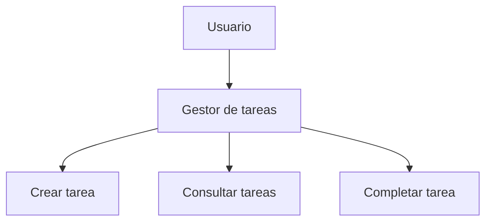

# EjercicioMarkdown
## Gestor de tareas

Aplicación sencilla para organizar tareas y consultar cuáles están completadas.

## Características

- Crear tareas.
- Consultar las tareas pendientes.
- Marcar tareas como completadas.

## Tecnologías utilizadas

- HTML
- CSS
- JavaScript
- Markdown

## Instalación

1. Clonar el repositorio.
2. Abrir la carpeta del proyecto.
3. Abrir el archivo `index.html` en el navegador.

## Funcionamiento

## Tareas pendientes

- [x] Crear el README.
- [x] Documentar las características.
- [ ] Mejorar el diseño.
- [ ] Añadir nuevas funcionalidades.

## Avisos

> [!NOTE]
> Este proyecto está pensado para practicar Markdown.

> [!WARNING]
> Guarda los cambios antes de cerrar el proyecto.

## Preguntas frecuentes

¿Cómo se abre el proyecto?

Abre el archivo `index.html` con un navegador.

¿Se pueden añadir nuevas funciones?

Sí, el proyecto se puede ampliar en el futuro.

## Historial de cambios

Puedes consultar los cambios del proyecto en el archivo [CHANGELOG.md](CHANGELOG.md).

## Licencia

Este proyecto utiliza la licencia MIT, que permite utilizar, modificar y compartir el código manteniendo el aviso de licencia.

## Autor

Alumno de 2º DAW.
