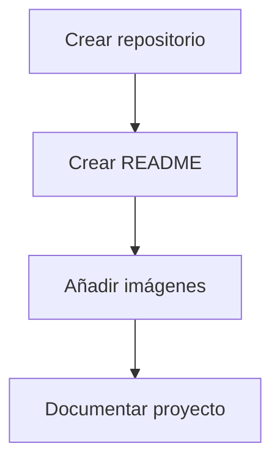

# Ejercicio Markdown


Este repositorio sirve para practicar el lenguaje Markdown y aprender a documentar proyectos.

## Características

- Crear títulos y listas.
- Añadir enlaces e imágenes.
- Utilizar tablas y bloques de código.
- Crear documentación para GitHub.

## Tecnologías utilizadas

- Markdown
- GitHub

## Imagen externa


## Imagen del repositorio


*Nota: cambia `foto.jpg` por el nombre real de tu imagen.*

## Ejemplo de código

```javascript
let mensaje = "Hola mundo";
console.log(mensaje);
```

## Tabla de ejemplo

| Nombre | Lenguaje |
|---|---|
| HTML | Marcado |
| JavaScript | Programación |
| Markdown | Documentación |

## Lista de tareas pendientes

- [x] Crear el repositorio.
- [x] Crear el README.md.
- [x] Añadir la carpeta images.
- [ ] Mejorar la documentación.
- [ ] Añadir más imágenes.

## Avisos

> [!NOTE]
> Este repositorio se utiliza para aprender Markdown.

> [!WARNING]
> Comprueba que las rutas de las imágenes sean correctas.

## Preguntas frecuentes

<details>
<summary>¿Qué es Markdown?</summary>

Es un lenguaje de marcado ligero que permite dar formato al texto de forma sencilla.

</details>

<details>
<summary>¿Para qué sirve el README?</summary>

Sirve para explicar el contenido y el funcionamiento de un proyecto.

</details>

## Diagrama



## Historial de cambios

Puedes consultar los cambios del proyecto en el archivo [CHANGELOG.md](CHANGELOG.md).

## Licencia

Este proyecto utiliza la licencia MIT, que permite utilizar, modificar y compartir el código manteniendo el aviso de licencia.

## Autor

Alumno de 2º DAW.
